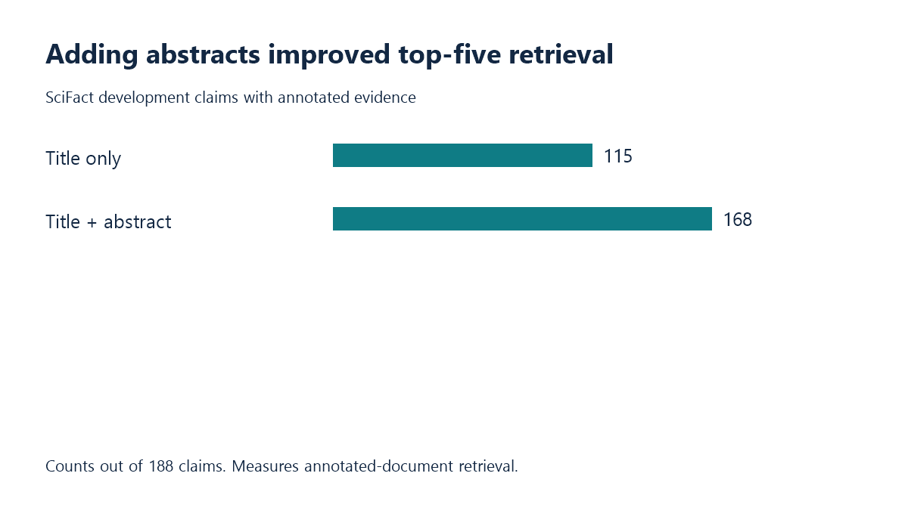
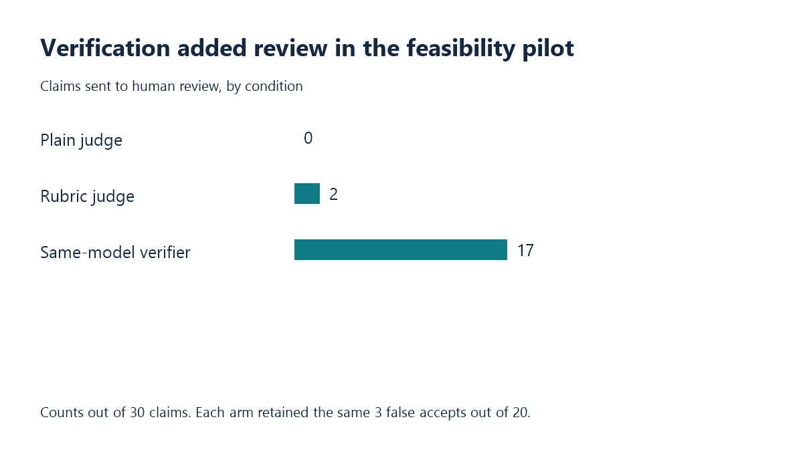
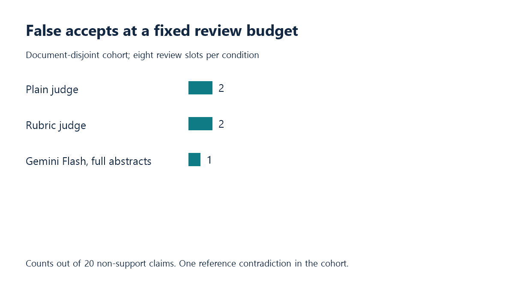

# Beyond Agreement: What Real LLM Judge Experiments Reveal About Evidence, Verification and Risk

**Publication:** [LinkedIn article](https://www.linkedin.com/pulse/beyond-agreement-what-real-llm-judge-experiments-reveal-waheed-abbas-lyfne/) · [LinkedIn announcement](https://www.linkedin.com/feed/update/urn:li:ugcPost:7532259796884975616/)  
**Reproducibility:** [Code and evidence](../README.md) · [Phase II+ protocol](VARE-PHASE-II-PLUS.md)

*From simulated calibration to public scientific-claim benchmarks and independent verifier experiments.*

## Abstract

Large language models are increasingly used to evaluate the outputs of other AI systems. While this approach offers a scalable method for assessing generated content, it introduces an important reliability problem: how can we establish that an automated evaluator detects the errors that matter most?

In my earlier research, I investigated judge calibration and selective review using a reproducible simulation. The study illustrated that improved probability calibration does not necessarily improve classification accuracy, and that deferring uncertain cases changes the balance between automation and review workload.

The next research question was whether these principles hold when actual language models evaluate scientific claims against retrieved evidence.

To investigate this, I developed a follow-up experimental framework using the public SciFact scientific fact-verification benchmark, GPT-4.1 Mini as the principal judge, and additional independent-verifier configurations involving Gemini 2.5 Flash and Gemini 2.5 Pro.

The work included evidence-retrieval evaluation, a 30-claim feasibility pilot, a 15-claim verifier follow-up, a 41-claim document-disjoint evaluation and a 97-claim contradiction-focused stress test.

The results were mixed. Evidence retrieval improved substantially when abstracts were included alongside titles. Some verifier configurations reduced false acceptance under fixed review budgets. However, additional verification did not consistently improve outcomes, and in some experiments it generated substantial review overhead without eliminating errors.

These findings suggest that reliable automated evaluation requires more than adding another model or improving a single agreement score. Evidence quality, evaluator independence, error classification, technical validity and review allocation must all be examined separately.

This article presents the experimental findings, their limitations and the next steps towards a more rigorous, risk-sensitive evaluation architecture.

## 1. The research problem: Can we trust the AI evaluating AI?

We are increasingly using AI systems to assess the responses of other AI systems.

One model produces an answer. Another judges whether it is correct, supported by evidence or acceptable under a defined set of criteria.

This is useful. Automated evaluation can help engineering teams test large numbers of responses, detect regressions and compare model versions.

But there is a fundamental distinction between receiving a high evaluation score and establishing that the evaluator is reliable.

An evaluator may agree with reference assessments most of the time and still miss a small number of important errors.

It may approve a numerical statement that is inconsistent with the source. It may accept a claim that exaggerates the underlying evidence. Or it may confidently interpret incomplete information as sufficient.

In high-consequence environments, these distinctions matter.

My original research investigated this issue through simulated calibration and selective review.

The next step was to move beyond simulated scores and examine the behaviour of actual LLM judges on a publicly available scientific benchmark.

## 2. How expert feedback changed the research direction

Following my earlier publication, several readers raised questions that I considered important enough to incorporate into the next experimental phase.

One observation was that an unsupported numerical claim and a minor wording issue should not necessarily carry the same evaluation cost.

Another was that a single review threshold might treat different categories of errors too similarly.

A further suggestion was to use independent checks for objectively verifiable information rather than relying entirely on LLM judgment.

These points exposed three weaknesses that deserved closer investigation.

**First, average agreement can hide consequential failures.**

A judge may perform well overall but still incorrectly accept particular classes of unsupported claims.

**Second, errors do not necessarily have equal consequences.**

The decision to accept, reject or escalate a claim should consider the nature of the possible error rather than relying exclusively on a universal confidence threshold.

**Third, a second model is not automatically an independent source of truth.**

Another LLM may reproduce the same mistake, interpret the same incomplete evidence incorrectly or introduce its own failures.

These became important considerations in the follow-up research.

The objective was no longer simply to improve evaluator scores.

It was to understand which verification mechanisms actually change the decisions that matter.

## 3. Moving from synthetic scores to public scientific evidence

The experimental work used SciFact, a publicly available scientific claim-verification benchmark introduced by Wadden and colleagues.

SciFact provides claims, scientific abstracts and evidence annotations that support evaluating whether a claim is supported, contradicted or lacks sufficient annotated evidence.

The retrieved research archive contained:

| Dataset component | Records |
|---|---:|
| Scientific abstracts | 5,183 |
| Labelled training claims | 809 |
| Labelled development claims | 300 |
| Official test claims | 300 |

The official test reference labels are withheld, so the experiments used available labelled data with documented selection procedures.

The 300 development claims comprised 124 supported claims, 64 contradicted claims and 112 without annotated supporting or contradicting evidence.

The evaluation distinguished three outcomes:

- **SUPPORT:** The available evidence supports the claim.
- **CONTRADICT:** The available evidence contradicts the claim.
- **INSUFFICIENT_EVIDENCE:** The evaluation does not establish adequate support or contradiction.

This is a scientific-evidence evaluation, not a regulatory approval assessment.

The public benchmark also does not provide the severity weights or expert MLR judgments needed to evaluate pharmaceutical content-review risk directly.

## 4. Experiment A: Does better evidence retrieval improve the foundation for judging?

Before evaluating the judge, I examined the retrieval stage.

An evaluator cannot reliably assess evidence it never receives.

The initial experiment compared two lexical retrieval configurations:

**Configuration A:** Scientific article titles.

**Configuration B:** Scientific article titles combined with abstracts.

Both used the available scientific corpus and were evaluated against annotated evidence-document references.

Among 188 development claims with annotated evidence, title-only retrieval found at least one annotated document in the top five for 115 claims.

Adding abstracts increased that number to 168.

| Retrieval measure | Title only | Title + abstract |
|---|---:|---:|
| Annotated document found in top 1 | 70/188 | 122/188 |
| Annotated document found in top 5 | 115/188 | 168/188 |
| Annotated document found in top 10 | 132/188 | 173/188 |

The top-five hit rate increased from 61.2% to 89.4%, an improvement of approximately 28.2 percentage points.

A paired claim-level bootstrap produced an illustrative 95% interval of approximately 21.8 to 35.1 percentage points for that improvement.

However, this interval assumes claim-level resampling and may underestimate uncertainty where claims share documents.

The improvement is meaningful for retrieving annotated documents.

It does not establish that the model correctly identifies the supporting sentence, interprets the evidence or makes the correct final judgment.

That distinction is important.

**Retrieving the right document is a necessary part of many evidence-based evaluations, but it does not guarantee the right conclusion.**

## 5. Experiment B: Does adding an independent verifier reduce false acceptance?

The next experiment introduced actual LLM inference.

A 30-claim feasibility sample was constructed with ten claims from each reference class.

GPT-4.1 Mini was used for the initial judge conditions, with a separate verifier call examining cited evidence.

The experiment compared three configurations.

**Plain judge:** An LLM judge using a basic evaluation prompt.

**Rubric judge:** The same judge using explicit criteria for scientific evidence.

**VARE feasibility configuration:** A rubric judge followed by a separate verification call using the same underlying model.

The primary concern was false acceptance: cases where the system automatically reported support despite a reference label indicating contradiction or insufficient evidence.

The results were:

| Configuration | False accepts | Cases routed for review | Automatic coverage |
|---|---:|---:|---:|
| Plain judge | 3 of 20 non-support claims | 0 of 30 | 100% |
| Rubric judge | 3 of 20 | 2 of 30 | 93.3% |
| VARE feasibility | 3 of 20 | 17 of 30 | 43.3% |

This was an important negative result.

The additional verification stage did not reduce false acceptance.

It left the same three unsupported or contradicted claims automatically accepted while sending substantially more cases for review.

In particular, the VARE feasibility condition routed eight of ten reference-supported claims for review.

The experiment also revealed output-format and citation-validation failures.

Across 80 model calls, 73 outputs passed validation. The remaining failures included invalid evidence citations and malformed verifier outputs.

The implication was clear.

**Adding another evaluation step does not automatically create a more reliable evaluation system.**

A second model call can add cost, reduce automatic coverage and still reproduce the original judge's mistakes.

## 6. Experiment C: Does verifier independence matter?

The next set of experiments examined whether changing the verification model and evidence scope affected outcomes.

The framework compared verifier configurations using the same underlying model, GPT-4.1 Mini, and a different model, Gemini 2.5 Flash.

It also compared verification using only cited sentences against verification using fuller retrieved abstracts.

A preliminary 15-claim development experiment exposed an important limitation: none of the baseline conditions falsely accepted a reference non-support claim before review.

Consequently, this sample could not establish whether the verifier was capable of correcting false acceptances.

Nevertheless, it helped identify parsing and evidence-scope issues.

Some Gemini outputs were enclosed in Markdown code fences, causing strict JSON validation failures despite apparently containing usable structured results.

This distinction matters because a failed parser does not necessarily indicate failed scientific reasoning.

The experiment also showed that changing the evidence from cited sentences to full abstracts could change an evaluator's verdict.

That observation provided a reason to examine evidence scope more carefully.

## 7. Experiment D: Document-disjoint evaluation

A subsequent evaluation selected 41 claims that shared no cited or annotated evidence documents with the training and earlier experimental claims.

This was intended to provide a stronger test than repeatedly evaluating familiar evidence.

The subset contained 21 supported claims, 19 insufficient-evidence claims and one contradicted claim.

Each method received the same budget of eight cases routed for review.

The results were:

| Evaluation configuration | False accepts remaining | Correct automatic accepts |
|---|---:|---:|
| Plain GPT-4.1 Mini | 2 | 13 |
| Rubric GPT-4.1 Mini | 2 | 17 |
| Same-model verifier, cited evidence | 2 | 17 |
| Same-model verifier, full abstracts | 2 | 17 |
| Gemini Flash verifier, cited evidence | 2 | 17 |
| Gemini Flash verifier, full abstracts | 1 | 18 |

The full-evidence Gemini configuration reduced residual false acceptance from two cases to one relative to the rubric-only approach.

It also preserved one additional correct automatic acceptance at the same review budget.

This was encouraging, but it would be premature to describe the architecture as validated.

The improvement was attributable to a very small number of cases.

Furthermore, with only one contradicted claim in the test subset, the experiment could not establish reliable performance across different contradiction types.

The appropriate conclusion is narrower:

**In this particular document-disjoint sample, a verifier using a different model and fuller evidence improved the allocation of a fixed review budget relative to the rubric-only condition.**

Whether the improvement generalises remains an open question.

## 8. Experiment E: Stress-testing contradicted scientific claims

The next experiment concentrated on contradictions.

A 97-claim development subset included:

- 47 contradicted claims.
- 25 insufficient-evidence claims.
- 25 supported claims.

The experiment used 19 review slots per method and compared plain judging, rubric judging, same-model verification and Gemini-based verification.

The remaining false acceptances after review were:

| Configuration | Contradicted claims falsely accepted | All false accepts |
|---|---:|---:|
| Plain GPT-4.1 Mini | 0 | 1 |
| Rubric GPT-4.1 Mini | 3 | 5 |
| Same-model verifier, cited evidence | 0 | 2 |
| Same-model verifier, full abstracts | 1 | 3 |
| Gemini Flash, cited evidence | 1 | 3 |
| Gemini Flash, full abstracts | 1 | 3 |
| Gemini Pro, full abstracts | 0 | 3 |

This experiment produced several observations.

First, an explicit rubric did not automatically improve performance over the plain judge under the selected review policy.

Second, a same-model verifier using cited evidence removed the residual contradiction false acceptances present in the rubric condition.

Third, a stronger verifier model was not consistently superior across the measured outcomes.

An especially important finding involved Gemini 2.5 Pro.

Some outputs were truncated because they reached the generation length limit.

These failed responses were routed for review under the evaluation policy.

As a result, the apparent improvement in contradiction acceptance partly reflected technical-failure handling rather than successful semantic verification.

The experiment therefore highlighted an important distinction:

**A system that refuses to make an automatic decision may prevent an incorrect acceptance without actually recognising why the claim is wrong.**

That is useful operational behaviour, but it should not be confused with improved reasoning accuracy.

The 97-claim subset also shared evidence-document relationships with training or earlier experimental claims. Consequently, it is best interpreted as a targeted development stress test, not independent evidence of broad generalisation.

## 9. What the results tell us about calibration and risk

The original simulation explored probability calibration and selective review.

The new SciFact experiments provide actual LLM judgments and verifier comparisons, but they do not yet provide a completed, held-out probability-calibration study.

Nor do they validate distinct cost weights for different types of scientific or regulatory errors.

Those questions remain part of the next research phase.

A possible risk-sensitive decision policy can be expressed as:

Risk(action) = Σ [P(error type i | evidence) × Cost(action, error type i)]

The principle is that evaluation decisions should consider both the probability and consequence of an error.

However, defining those costs requires care.

Public scientific fact-verification labels do not establish the regulatory or operational consequences of particular mistakes.

The proposed architecture therefore needs independent error-severity assessments, appropriate reference standards and sensitivity analysis across different cost assumptions.

Without that work, a risk-weighted score could introduce another form of arbitrary judgment rather than improve evaluation reliability.

## 10. Towards a stronger hybrid evaluation architecture

Based on the experiments, I believe the next architectural iteration should separate five responsibilities.

**1. Evidence retrieval**

Identify the documents and passages relevant to a claim, while preserving provenance and source context.

**2. Semantic evaluation**

Use an LLM to assess whether the evidence supports, contradicts or is insufficient to establish the claim.

**3. Independent verification**

Apply separately validated checks where possible, particularly for numerical consistency, units, dates, denominators and structured relationships.

Use additional semantic verification where deterministic rules are insufficient, while explicitly accounting for correlated model errors.

**4. Risk-sensitive review decisions**

Calibrate error probabilities using independent reference assessments and allocate a limited review budget according to prespecified error categories and consequences.

**5. Traceable evaluation outcomes**

Record the model version, prompts, evidence, citations, verification results, parsing failures and final decisions.

This separation should make it easier to determine why a system improved or failed.

It also prevents a successful review-routing policy from being mistaken for improved semantic understanding.

An important limitation of the experiments completed so far is that the implemented independent verifier was another LLM call. A full deterministic numerical and logical verification engine has not yet been validated against the proposed benchmark.

That remains a critical next step.

## 11. What the next experimental phase must establish

The findings lead to several specific research requirements.

**Controlled numerical errors**

Construct paired valid and invalid statements in which numbers, populations, endpoints, dates or units are deliberately changed.

Test whether deterministic verification identifies these mistakes and whether the extracted source relationships are correct.

**Different error consequences**

Develop an independently reviewed severity framework that distinguishes minor formatting issues, unsupported factual claims, material omissions and other consequential failures.

**Calibrated review decisions**

Compare common thresholds with category-sensitive review policies under the same human-review budget.

**Evidence stability**

Test whether removing irrelevant evidence leaves a correct judgment unchanged, while removing the last adequate supporting source appropriately changes the outcome.

**Independent verification**

Measure how often a verifier genuinely corrects a judge's mistake rather than repeating it or sending the case for review because of a technical failure.

**Statistical generalisation**

Evaluate larger, document-grouped held-out datasets and external benchmarks, with confidence intervals, prespecified success criteria and transparent failure analysis.

These tests would provide a more direct assessment of whether the proposed architecture adds value beyond simpler alternatives.

## 12. Reproducibility

The research code, public dataset provenance, experimental protocol and recorded results are available in the public repository:

**GitHub:** https://github.com/wakhan-ai/llm-judge-calibration

The SciFact research package contains the lexical retrieval implementation, judge runner, verifier follow-up code, experiment manifests, and machine-readable summary outputs.

The recorded work includes real API-based model inference, but the published evidence is not a substitute for independent reproduction. Repeated inference may also differ because of model versions, provider routing and generation settings.

The earlier 600-record calibration simulation remains a separate methodological demonstration and should not be confused with the real-model SciFact experiments.

## 13. Conclusion: What makes an AI evaluator trustworthy?

The experiments have reinforced an important lesson.

A more complex evaluation architecture is not automatically a more reliable one.

Adding an explicit rubric may not improve every judgment.

Adding a second LLM may reproduce the first model's mistakes.

Providing more evidence may help in some cases while leaving other failures unresolved.

And routing uncertain or technically invalid outputs for human review can reduce automatic acceptance without demonstrating better scientific reasoning.

I believe reliable AI evaluation needs to be understood as a complete decision process rather than a single model score.

It requires evidence quality, well-defined evaluation criteria, independent checks, explicit uncertainty, measured error consequences and accountable review decisions.

The work completed so far does not establish a universally superior architecture.

It does, however, identify concrete failure modes, demonstrate several measurable trade-offs and provide a reproducible foundation for the next experiments.

The central question remains:

**Can we build an AI evaluation system that not only identifies when an answer may be wrong, but can reliably distinguish what is wrong, why it matters and when human judgment is necessary?**

That is the direction I intend to pursue.

**The goal is not to build an AI judge that always agrees. It is to build an evaluation process whose decisions can be tested, explained and independently challenged.**

---

## Selected references and research resources

1. Gu et al. *A Survey on LLM-as-a-Judge.* https://arxiv.org/abs/2411.15594

2. Shankar et al. (UIST 2024). *Who Validates the Validators? Aligning LLM-Assisted Evaluation of LLM Outputs with Human Preferences.* https://arxiv.org/abs/2404.12272

3. Wadden et al. (EMNLP 2020). *Fact or Fiction: Verifying Scientific Claims.* https://aclanthology.org/2020.emnlp-main.609/

4. Allen Institute for AI. *SciFact Dataset and Benchmark.* https://github.com/allenai/scifact

5. *LLM Judge Calibration — Phase II SciFact Experiments.* https://github.com/wakhan-ai/llm-judge-calibration/tree/main/phase-2-scifact

6. scikit-learn. *Probability Calibration.* https://scikit-learn.org/stable/modules/calibration.html

*Disclaimer: This independent research uses public benchmark data and includes experimental findings subject to the stated methodological limitations. The conclusions do not represent any organisation.*

---

## From Experimental Findings to the Next Research Questions

One of the most valuable aspects of this research has been the feedback received from practitioners following my earlier publication.

Several observations challenged important assumptions about automated evaluation, particularly whether all errors should be treated equally, whether independent verification can improve reliability, and whether an evaluator can distinguish between sufficient and insufficient evidence.

The experiments presented in this article have begun to investigate these questions. However, they have also exposed additional weaknesses that require further investigation.

Rather than treating these limitations simply as shortcomings, I see them as an opportunity to develop a more comprehensive and experimentally testable approach.

This forms the basis of the next research iteration.

## VARE Research Phase II+ — Completing the Missing Evidence

VARE (Verifiable and Adaptive Risk Evaluation) is the working name for a proposed research architecture that brings together semantic evaluation, independent verification, probability calibration and risk-sensitive decision-making.

The objective is to investigate whether these mechanisms, individually and collectively, can improve the reliability of automated evaluation without introducing unnecessary complexity, false alarms or human-review overhead.

The next iteration will focus on seven areas.

### 1. Deterministic numerical and contextual verification

Some claims should not depend entirely on the interpretation of a language model.

Numerical values, units, percentages, dates, denominators and relationships between structured data can often be independently verified.

However, matching a number against a source is not sufficient. A correct number associated with the wrong population, endpoint or time period can still produce a misleading claim.

The proposed experiments will compare LLM-based evaluation with deterministic verification, using controlled valid and invalid claims to measure error detection, false alarms and extraction accuracy.

### 2. Evidence sensitivity and stability

A reliable evaluator should change its judgment when the underlying evidence no longer supports a claim, but it should also maintain a correct judgment when irrelevant information is removed.

For example, where two independent documents adequately support a claim, removing one should not necessarily change the outcome. Removing the last adequate source should.

The next experiments will introduce controlled evidence transformations to measure both appropriate revision and appropriate stability.

This will help distinguish genuine evidence sensitivity from unnecessary hesitation whenever the retrieval set changes.

### 3. Error severity and risk-sensitive evaluation

Not every evaluation error carries the same consequences.

Accepting an unsupported scientific claim may be considerably more consequential than accepting a minor wording inconsistency.

A proposed decision framework will therefore investigate both the probability of an error and its potential impact:

**Expected Risk = Σ [P(Errorᵢ) × Cost(Errorᵢ)]**

The intention is to compare universal decision thresholds with category-sensitive review policies under equivalent human-review budgets.

Defining meaningful error costs will require independently reviewed severity criteria and sensitivity analysis. The current public benchmark does not establish these costs, and they should not be assumed without validation.

### 4. Probability calibration and decision quality

The original computational study demonstrated why calibration and classification accuracy should be considered separately.

The next iteration will investigate this relationship using actual model outputs.

Calibration methods will be fitted on designated development data and evaluated against separate held-out cases using probability-based metrics, reliability diagrams and risk–coverage analysis.

The central question is whether better probability estimates lead to better operational decisions, rather than simply producing better calibration scores.

### 5. Verifier independence and correlated failures

The current experiments demonstrate that adding another LLM does not necessarily eliminate the original judge's mistakes.

The next phase will examine the circumstances under which different evaluators make the same errors, disagree appropriately or introduce new failures.

Same-model verification, cross-model verification and deterministic checks will be compared independently.

Technical failures, such as invalid citations, malformed responses and truncated outputs, will also be distinguished from genuine semantic error detection.

### 6. Statistical validation and architectural ablation

The contribution of each component must be measurable.

The proposed architecture will be evaluated against simpler alternatives, with individual components removed or replaced to determine whether they add meaningful value.

Experiments will use grouped data partitions, matched review budgets, paired comparisons and appropriate uncertainty estimates.

The objective is not to demonstrate that a more complex architecture is necessarily better, but to establish which components improve reliability and under what conditions.

### 7. Generalisation beyond the initial benchmark

SciFact provides a valuable starting point for scientific-claim evaluation, but it cannot represent every type of evidence or operational environment.

The next iteration will explore additional public benchmarks, including datasets containing structured tables and more complex evidence relationships.

This will help establish whether the observed behaviour is specific to SciFact or reflects broader characteristics of automated evaluation systems.

## The proposed research outcome

The next iteration is intended to produce a reproducible experimental framework containing:

- Public benchmark data and documented provenance.
- Controlled valid and invalid claim pairs.
- Deterministic numerical and contextual verification methods.
- Evidence-removal and stability experiments.
- Calibrated error-probability estimates.
- Risk-sensitive decision policies.
- Comparative architecture and ablation results.
- Statistical analysis, failure attribution and reproducible research code.

These are proposed research deliverables, not completed findings.

The existing experiments provide the foundation for this work, while the next iteration will investigate the remaining questions through measurable outcomes.

## Continuing the research

I believe the reliability of AI evaluation should be examined as an end-to-end decision process rather than as an isolated model score.

The important question is not simply whether an AI judge agrees with another evaluator. It is whether the overall system can identify unsupported claims, recognise the significance of different errors, verify what can be independently verified and determine when human judgment is necessary.

The findings presented here have challenged several of my initial assumptions. That is precisely what makes the next stage interesting.

The research will continue with the same principle: publish the methodology, report the findings, make the limitations visible and allow the evidence to determine the conclusions.

I welcome further technical perspectives from researchers and practitioners working in this area.
